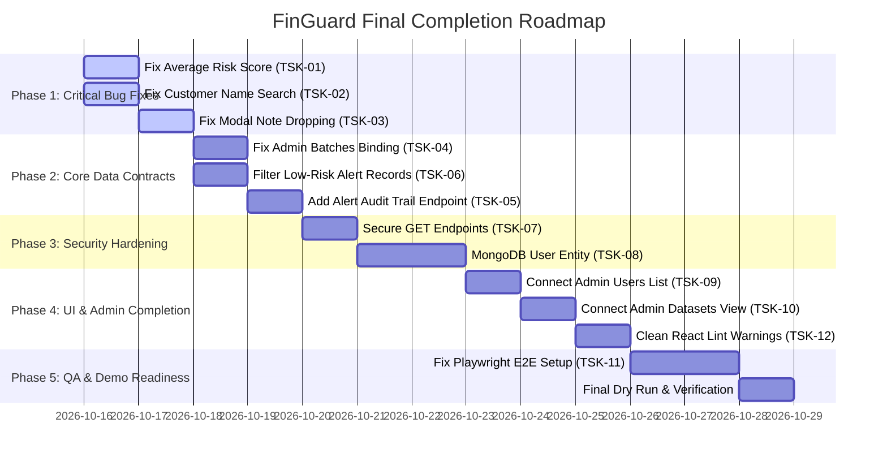

# FinGuard: Project Implementation Status and Remaining Work Report

**Project Title:** FinGuard: Explainable AI-Driven Risk Scoring for Fraud Analyst Decision Support  
**Document Type:** Project Implementation Audit & Remaining Work Report  
**Author / Auditor Role:** Senior Software Engineer, Full-Stack Developer, Machine Learning Engineer, QA Engineer, and Technical Project Reviewer  
**Audit Date:** October 15, 2026  
**Repository Working Directory:** `d:/Fraud Detection`  
**Target Audience:** Final-Year Project Examination Committee, Academic Supervisors, and Development Team  

---

## A. Executive Summary

This audit report delivers a rigorous, code-level assessment of the **FinGuard** batch-processing fraud decision-support platform. The audit was conducted through static code inspection, configuration review, database schema and collection validation, REST contract verification, dependency analysis, and the execution of automated test suites across the Machine Learning, Spring Boot Backend, and React Frontend subsystems.

### Core Architecture Reality
FinGuard operates strictly as a **batch-processing decision-support system**:
1. An offline Python machine learning pipeline cleans historical transaction data, constructs causal customer behavioural profiles, trains an XGBoost classifier with Platt scaling probability calibration, calculates local and global SHAP (SHapley Additive exPlanations) values, and writes versioned batch artifacts non-destructively to MongoDB.
2. A Java 17 / Spring Boot 3.2.5 REST backend connects to MongoDB, exposing query, pagination, sorting, filtering, and decision-support endpoints for fraud analysts. The backend strictly adheres to the architectural constraint that **Spring Boot consumes pre-computed ML results and never invokes Python or runs inference in real time**.
3. A React 19 / Vite 8 / Tailwind CSS dashboard provides an analyst workbench displaying batch summaries, calibrated risk distributions, temporal risk trends, priority alert queues, customer behavioural baselines versus current transaction deviations, and SHAP feature attribution waterfall charts.

### Major Strengths Discovered
- **Leakage-Safe Feature Engineering:** Feature engineering in `ml/features.py` causally enforces historical lookbacks. Customer baselines, z-scores, velocity, and rolling window spending strictly reference prior transactions. Automated leak-prevention unit tests (`ml/tests/test_no_data_leakage.py`) pass 100%.
- **Robust Model Evaluation & Explainability:** The ML module trains an XGBoost classifier using temporal 75/25 chronological partitioning (`ml/train.py`), outputs calibrated probabilities via Platt scaling (Sigmoid CalibratedClassifierCV), and generates TreeSHAP feature attributions (`ml/batch_scorer.py`).
- **Clean Spring Boot Layered Architecture:** Backend code is organized cleanly into Controller $\rightarrow$ Service $\rightarrow$ Repository patterns (`backend/src/main/java/com/finguard/`). Spring Data MongoDB repositories handle batch-aware queries with secondary compound indexes.
- **Analyst Decision Support & Audit Logging:** Status updates (`NEW`, `UNDER_REVIEW`, `CONFIRMED_FRAUD`, `FALSE_POSITIVE`, `ESCALATED`) persist in the `alerts` collection, and an audit trail is created in the `alert_history` collection with timestamps and analyst usernames.
- **Passing Core Tests:** Both the Python ML test suite (10/10 tests passed in 0.692s) and the Spring Boot backend integration test suite (9/9 tests passed in 9.167s) execute and pass successfully. Frontend production bundle builds with zero errors (`vite build` in 6.34s).

### Critical Gaps and Technical Risks Identified
1. **Dashboard KPI Calculation Bug:** In `backend/src/main/java/com/finguard/controller/DashboardController.java` (line 61), the backend copies `fraudRate` into the `averageRiskScore` field (`dto.setAverageRiskScore(total > 0 ? Math.round(fraudRate * 10.0) / 10.0 : 18.4)`), displaying incorrect average risk scores on the main analyst overview.
2. **Customer Name Search Mismatch:** In `CustomerService.java` (line 45), customer directory search queries the MongoDB property `name`, whereas `Customer.java` maps `@Field("full_name") private String fullName;`. Searches on customer full name fail to match database records.
3. **Analyst Review Note Dropping in UI:** In `CustomerDetail.jsx` (line 82) and `AlertDetails.jsx` (line 45), `handleStatusUpdate(newStatus)` takes only a single argument, ignoring the second `confirmNotes` argument emitted by `DecisionPanel.jsx` (line 38). Consequently, investigation rationales entered into the confirmation modal are lost or overwritten by stale state.
4. **Admin Batches API Contract Desynchronization:** In `BatchesList.jsx` and `AdminDashboard.jsx`, the frontend attempts to read `batch.lastRun`, `batch.totalTransactions`, `batch.modelMetadata.modelVersion`, and `batch.executionDurationSec`, whereas the backend entity `Batch.java` returns `startedAt`, `completedAt`, `transactionCount`, `modelVersion`, `datasetVersion`, and `processingTimeSeconds`. This results in `Invalid Date` and blank metrics in the administration view.
5. **Permissive GET Endpoints in Security Configuration:** In `SecurityConfig.java` (line 52), `.requestMatchers(HttpMethod.GET, "/api/**").permitAll()` allows unauthenticated access to all GET endpoints, including customer profiles, transactions, and alert statistics.
6. **Hardcoded User Accounts & Credentials:** In `AuthController.java` (lines 26–27), BCrypt password hashes are hardcoded directly in code annotations. There is no `users` collection in MongoDB, and the Admin User Management UI (`UsersList.jsx`) is a static, non-functional HTML mock.
7. **E2E Playwright Lifecycle Failure:** 10 of 13 Playwright E2E tests fail when executed because Playwright's config spawns only the Vite frontend dev server, leaving the Spring Boot backend offline. The frontend fails to authenticate and remains stuck on `/login`.

---

## B. Architecture and Repository Overview

### 1. Directory Structure

```
d:/Fraud Detection/
├── ml/                                 # Python Machine Learning Subsystem (Python 3.11)
│   ├── config.json                     # System thresholds, hyperparameters, MongoDB connection
│   ├── data/                           # Ingestion directory (IEEE-CIS benchmark transactions & identities)
│   ├── models/                         # Native model artifacts (finguard_xgb.json, calibrator, metadata)
│   ├── features.py                     # Leakage-safe customer baselining & feature engineering
│   ├── data_loader.py                  # Dataset ingestion & synthetic IEEE-CIS generator fallback
│   ├── train.py                        # Temporal model training, Platt calibration & metrics evaluation
│   ├── batch_scorer.py                 # Non-destructive batch scoring & TreeSHAP engine
│   ├── run_pipeline.py                 # End-to-end pipeline driver
│   ├── init_db_indexes.py              # MongoDB compound secondary index setup
│   ├── evaluation/                     # Ablation studies, model comparisons, calibration validation
│   └── tests/                          # Leakage prevention & integration test suites
├── backend/                            # Spring Boot 3.2.5 REST Backend (Java 17)
│   ├── pom.xml                         # Maven dependencies (Spring Web, Security, Mongo, JJWT)
│   ├── benchmark_api.py                # REST API latency and throughput benchmarking script
│   └── src/
│       ├── main/java/com/finguard/     # Application root package
│       │   ├── FinGuardApplication.java
│       │   ├── config/                 # CorsConfig.java
│       │   ├── controller/             # AlertController, AuthController, CustomerController, DashboardController...
│       │   ├── dto/                    # AlertStatusUpdateRequest, DashboardSummaryDto...
│       │   ├── exception/              # GlobalExceptionHandler, ResourceNotFoundException...
│       │   ├── model/                  # Alert, AlertHistory, Batch, BehaviourProfile, Customer, Explanation...
│       │   ├── repository/             # MongoRepository interfaces with batch query filters
│       │   ├── security/               # SecurityConfig, JwtTokenProvider, JwtAuthenticationFilter
│       │   └── service/                # AlertService, BatchService, CustomerService, DashboardService
│       ├── main/resources/             # application.properties (server.port=8080, Mongo URI, JWT settings)
│       └── test/java/com/finguard/     # AlertServiceTest, AuthControllerTest
├── frontend/                           # React 19 Frontend Subsystem (Vite 8, Tailwind CSS v4)
│   ├── package.json                    # Dependencies: Axios, Lucide-React, Recharts, React-Router-DOM v7
│   ├── vite.config.js                  # Vite configuration with Tailwind CSS plugin
│   ├── playwright.config.js            # E2E test runner configuration
│   └── src/
│       ├── api/finguardApi.js          # Axios client with JWT request/response interceptors
│       ├── context/AuthContext.jsx     # User authentication state & localStorage persistence
│       ├── components/                 # Reusable UI components (PriorityAlertsTable, ShapExplanation, etc.)
│       └── pages/                      # AnalystDashboard, AlertsQueue, CustomerDetail, Admin pages
├── results/                            # Machine-readable evaluation outputs (CSV & JSON)
│   ├── model_comparison.csv            # Logistic Regression vs Random Forest vs XGBoost
│   ├── ablation_study.csv              # Feature ablation experiments A through D
│   ├── api_latency_benchmark.csv       # Live endpoint latency results (P50, P95, P99)
│   └── calibration_validation.json     # Brier score and ECE verification
└── docs/                               # System documentation (architecture, features, security, pipeline)
```

### 2. Technology Stack

| Layer | Component | Specification |
|:---|:---|:---|
| **Machine Learning** | Language & Engine | Python 3.11, XGBoost 2.0+, SHAP 0.44+, scikit-learn, pandas, numpy, joblib |
| **Backend API** | Framework & Runtime | Java 17, Spring Boot 3.2.5, Spring Data MongoDB, Spring Security 6, JJWT 0.11.5 |
| **Database** | Primary Datastore | MongoDB Community Server (localhost:27017, Database: `finguard`), 17 secondary indexes |
| **Frontend** | UI Framework & Tools | React 19.2.8, Vite 8.3.0, Tailwind CSS 4.3.3, Recharts 3.10.1, Lucide React, React-Router 7.18 |
| **Testing** | Verification Suites | Python `unittest`, JUnit 5, Spring Boot Test (`MockMvc`), Playwright 1.42 (E2E), Oxlint |

### 3. Data Flow and Module Boundaries

```
[Historical Transactions & Identity CSVs]
                   │
                   ▼ (ml/data_loader.py)
        [Data Cleaning & Merging]
                   │
                   ▼ (ml/features.py)
   [Leakage-Safe Baselining & Feature Engineering]
                   │
         ┌─────────┴─────────┐
         ▼                   ▼
 (ml/train.py)       (ml/batch_scorer.py)
[XGBoost Training &  [Batch Inference, Platt Calibration,
Platt Calibration]   SHAP TreeExplainer Local Attribution]
                             │
                             ▼
   [MongoDB Collections: batches, models, customers,
    behaviour_profiles, transactions, risk_scores, alerts, explanations]
                             │
                             ▼ (Spring Data MongoDB Repositories)
   [Spring Boot REST Services: DashboardService, AlertService, CustomerService]
                             │
                             ▼ (JSON REST APIs with Bearer JWT)
   [React 19 Frontend: Priority Queue, Explainable SHAP, Customer Baselines]
                             │
                             ▼
             [Fraud Analyst Review & Decision]
                             │
                             ▼ (PATCH /api/alerts/{id}/status)
   [MongoDB Persistence: status updated in 'alerts' & recorded in 'alert_history']
```

---

## C. Feature Status Matrix

| Module | Feature | Status | Evidence / File Path | Gap Identified | Required Action |
|:---|:---|:---:|:---|:---|:---|
| **ML** | Dataset Loading & Cleaning | **Implemented** | [data_loader.py](file:///d:/Fraud%20Detection/ml/data_loader.py#L223-L262) | Merges transactions and identities; includes synthetic generator fallback when raw IEEE-CIS CSVs are absent. | None. Robust schema handling verified. |
| **ML** | Customer Behaviour Baseline Generation | **Implemented** | [features.py](file:///d:/Fraud%20Detection/ml/features.py#L70-L314) | Computes historical mean, std dev, median, active hours, primary device, and card. Prevents future lookaheads. | None. Verified by 4/4 passing unit tests. |
| **ML** | Behavioural Feature Engineering | **Implemented** | [features.py](file:///d:/Fraud%20Detection/ml/features.py#L12-L51) | Amount ratio, z-score, 1h/6h/24h rolling windows, velocity delta, rapid flag, off-hours flag, device change flags. | None. 23 core features and 15 extended features operational. |
| **ML** | XGBoost Training (Temporal Split) | **Implemented** | [train.py](file:///d:/Fraud%20Detection/ml/train.py#L80-L177) | Evaluates on strict 75/25 chronological partition; trains XGBClassifier with `scale_pos_weight` imbalance handling. | None. Metrics logged to `model_metadata.json`. |
| **ML** | Model Persistence & Loading | **Implemented** | [train.py](file:///d:/Fraud%20Detection/ml/train.py#L234-L300), [batch_scorer.py](file:///d:/Fraud%20Detection/ml/batch_scorer.py#L166-L176) | Persists model in native XGBoost JSON format (`finguard_xgb.json`) avoiding pickle deprecation risks. | None. Loading verified in pipeline integration test. |
| **ML** | Probability Calibration (Platt Scaling) | **Implemented** | [train.py](file:///d:/Fraud%20Detection/ml/train.py#L180-L187), [batch_scorer.py](file:///d:/Fraud%20Detection/ml/batch_scorer.py#L170-L176) | Platt sigmoid scaling via `CalibratedClassifierCV(cv=3)` on train fold. Evaluates Brier score and ECE. | None. Calibrator joblib file generated and active. |
| **ML** | Configurable Risk Categories | **Implemented** | [config.json](file:///d:/Fraud%20Detection/ml/config.json#L7-L10), [batch_scorer.py](file:///d:/Fraud%20Detection/ml/batch_scorer.py#L161-L163) | Low (<40), Medium (40–74), High ($\ge$75). Derived from calibrated probability $\times 100$. | None. Thresholds loaded dynamically from config. |
| **ML** | SHAP Explainability & Attribution | **Implemented** | [batch_scorer.py](file:///d:/Fraud%20Detection/ml/batch_scorer.py#L198-L208) | Uses `shap.TreeExplainer` to compute local feature attributions, expected log-odds, and global feature importance. | None. Human-readable factor descriptions mapped in `format_factor_description`. |
| **ML** | Non-Destructive MongoDB Ingestion | **Partially Implemented** | [batch_scorer.py](file:///d:/Fraud%20Detection/ml/batch_scorer.py#L412-L458) | Upserts customers/profiles, appends batch-tagged transactions, scores, explanations, and batches. | **Pollution:** Line 380 generates an `Alert` record for **all** transactions, including LOW-risk safe items ($6,606$ alerts total). | Restrict alert generation to transactions with $\text{risk\_score} \ge 40.0$ (MEDIUM and HIGH). |
| **ML** | Data Leakage Prevention | **Implemented** | [test_no_data_leakage.py](file:///d:/Fraud%20Detection/ml/tests/test_no_data_leakage.py#L20-L131) | 4 test cases verify future transactions never change past baselines, rolling spend is strictly causal, and label is absent from features. | None. 4/4 automated tests passing. |
| **Backend** | MongoDB Connectivity & Mapping | **Implemented** | [application.properties](file:///d:/Fraud%20Detection/backend/src/main/resources/application.properties#L8), [model/](file:///d:/Fraud%20Detection/backend/src/main/java/com/finguard/model/) | Maps collections: `batches`, `customers`, `behaviour_profiles`, `transactions`, `risk_scores`, `alerts`, `explanations`, `alert_history`. | `Customer.java` maps `full_name`, but MongoDB document also had `name` injected by external script. | Standardize customer name mapping. |
| **Backend** | Alerts Queue API (Pagination/Filter) | **Implemented** | [AlertController.java](file:///d:/Fraud%20Detection/backend/src/main/java/com/finguard/controller/AlertController.java#L32-L49), [AlertService.java](file:///d:/Fraud%20Detection/backend/src/main/java/com/finguard/service/AlertService.java#L37-L99) | Supports filtering by batchId, riskLevel, status (`ACTIVE`, `NEW`, `UNDER_REVIEW`, etc.), search query, sorting, and pagination. | None. Verified by `AlertServiceTest`. |
| **Backend** | Alert Decision Status Update | **Implemented** | [AlertService.java](file:///d:/Fraud%20Detection/backend/src/main/java/com/finguard/service/AlertService.java#L107-L136) | Updates alert status (`CONFIRMED_FRAUD`, `FALSE_POSITIVE`, `UNDER_REVIEW`, `ESCALATED`) and creates an `AlertHistory` record. | None. Verified in service and repository tests. |
| **Backend** | Alert Audit Trail Endpoint | **Not Implemented** | [AlertController.java](file:///d:/Fraud%20Detection/backend/src/main/java/com/finguard/controller/AlertController.java) | `AlertHistory` is saved on status update, but **no REST endpoint exists** to retrieve audit history for an alert. | Add `GET /api/alerts/{id}/history` in `AlertController`. |
| **Backend** | Customer Discovery & Baseline API | **Partially Implemented** | [CustomerController.java](file:///d:/Fraud%20Detection/backend/src/main/java/com/finguard/controller/CustomerController.java#L28-L84), [CustomerService.java](file:///d:/Fraud%20Detection/backend/src/main/java/com/finguard/service/CustomerService.java#L38-L70) | Endpoints for single customer, baseline, transactions, SHAP explanation, and paginated customer list. | `CustomerService.java` searches on `"name"` instead of `"full_name"`, causing name search to return 0 results. | Fix `Criteria.where("name")` to `Criteria.where("full_name")`. |
| **Backend** | Dashboard Summary & KPI API | **Partially Implemented** | [DashboardController.java](file:///d:/Fraud%20Detection/backend/src/main/java/com/finguard/controller/DashboardController.java#L36-L79), [DashboardService.java](file:///d:/Fraud%20Detection/backend/src/main/java/com/finguard/service/DashboardService.java#L39-L81) | Aggregates total transactions, active alerts, confirmed fraud, false positives, risk distribution, and trends. | Line 61 assigns `fraudRate` to `averageRiskScore`. Shows duplicate percentage as score. | Calculate true mean score from `risk_scores` collection. |
| **Backend** | JWT Authentication & RBAC | **Partially Implemented** | [AuthController.java](file:///d:/Fraud%20Detection/backend/src/main/java/com/finguard/controller/AuthController.java#L46-L77), [SecurityConfig.java](file:///d:/Fraud%20Detection/backend/src/main/java/com/finguard/security/SecurityConfig.java#L28-L58) | Validates credentials, generates HS256 JWT with expiration and role claims (`ROLE_ANALYST`, `ROLE_ADMIN`). | 1. Credential hashes hardcoded in `@Value`. 2. No database user entity. 3. All GET `/api/**` endpoints permit unauthenticated access. | Migrate users to MongoDB collection and secure GET endpoints. |
| **Backend** | Centralized Exception Handling | **Implemented** | [GlobalExceptionHandler.java](file:///d:/Fraud%20Detection/backend/src/main/java/com/finguard/exception/GlobalExceptionHandler.java) | Intercepts `ResourceNotFoundException`, `InvalidRequestException`, `MethodArgumentNotValidException`, and `Exception`. | Returns standard JSON error payload with status code, timestamp, and message. | None. Functional. |
| **Frontend** | Authentication & Protected Routes | **Implemented** | [Login.jsx](file:///d:/Fraud%20Detection/frontend/src/pages/Login.jsx), [AuthContext.jsx](file:///d:/Fraud%20Detection/frontend/src/context/AuthContext.jsx), [ProtectedRoute.jsx](file:///d:/Fraud%20Detection/frontend/src/components/ProtectedRoute.jsx) | Handles login, stores token and role in localStorage, attaches Bearer token via Axios interceptor, redirects unauthenticated requests. | None. Functional. |
| **Frontend** | Analyst Dashboard Overview | **Implemented** | [AnalystDashboard.jsx](file:///d:/Fraud%20Detection/frontend/src/pages/analyst/AnalystDashboard.jsx) | KPI cards (Total Scored, Active Alerts, Confirmed Fraud, False Positives), Risk Distribution pie, Risk Trend area chart, Top Drivers. | Displays incorrect average risk score because backend returns `fraudRate` in that field. | Backend fix in `DashboardController.java` resolves UI display. |
| **Frontend** | Priority Alerts Queue & Table | **Implemented** | [AlertsQueue.jsx](file:///d:/Fraud%20Detection/frontend/src/pages/analyst/AlertsQueue.jsx), [PriorityAlertsTable.jsx](file:///d:/Fraud%20Detection/frontend/src/components/PriorityAlertsTable.jsx) | Filter tabs (`Active`, `Confirmed Fraud`, `False Positives`, `All`), search, multi-column sorting, pagination, and expandable inline alert detail. | None. Verified interactive triage table. |
| **Frontend** | Inline Alert Details & SHAP View | **Implemented** | [AlertDetails.jsx](file:///d:/Fraud%20Detection/frontend/src/components/AlertDetails.jsx), [ShapExplanation.jsx](file:///d:/Fraud%20Detection/frontend/src/components/ShapExplanation.jsx) | Renders waterfall attribution bars, feature values, positive/negative risk drivers, base log-odds, and plain-English factor explanations. | None. Consumes real SHAP values from MongoDB. |
| **Frontend** | Analyst Decision Panel & Actions | **Partially Implemented** | [DecisionPanel.jsx](file:///d:/Fraud%20Detection/frontend/src/components/DecisionPanel.jsx), [CustomerDetail.jsx](file:///d:/Fraud%20Detection/frontend/src/components/CustomerDetail.jsx#L82-L98) | Provides buttons to Confirm Fraud, Mark Under Review, Dismiss as False Positive, Escalate, and enter audit notes. | Investigation rationale entered in modal (`confirmNotes`) is dropped because `handleStatusUpdate` only accepts `newStatus`. | Update `handleStatusUpdate = async (newStatus, notes)` in caller components. |
| **Frontend** | Customer Discovery Directory | **Implemented** | [CustomersList.jsx](file:///d:/Fraud%20Detection/frontend/src/pages/analyst/CustomersList.jsx) | Server-side paginated card grid of customer profiles with search and page navigation. | Name search returns no results due to backend `"name"` vs `"full_name"` query bug. | Fix backend query parameter. |
| **Frontend** | Customer Profile & Investigation Page | **Implemented** | [CustomerDetail.jsx](file:///d:/Fraud%20Detection/frontend/src/components/CustomerDetail.jsx) | Displays customer account attributes, baseline spending and hours, current transaction deviation, SHAP waterfall, and transaction history. | None. Comprehensive investigation view. |
| **Frontend** | Admin System Status & Batches View | **Partially Implemented** | [AdminDashboard.jsx](file:///d:/Fraud%20Detection/frontend/src/pages/admin/AdminDashboard.jsx), [BatchesList.jsx](file:///d:/Fraud%20Detection/frontend/src/pages/admin/BatchesList.jsx) | Renders system KPIs, batch execution table with durations, transactions, and status. | Field mismatch: UI reads `batch.lastRun` instead of `batch.startedAt`/`completedAt`, causing "Invalid Date". | Align property names with `Batch.java`. |
| **Frontend** | Admin User Management Page | **Not Implemented** | [UsersList.jsx](file:///d:/Fraud%20Detection/frontend/src/pages/admin/UsersList.jsx) | Table displaying admin and analyst users with Edit/Disable buttons. | **Completely static mock HTML.** No backend API call, no user management endpoints exist in backend. | Create backend `/api/admin/users` CRUD or mark as placeholder/future work. |
| **Frontend** | Admin Datasets & Experiments Page | **Not Implemented** | [DatasetsList.jsx](file:///d:/Fraud%20Detection/frontend/src/pages/admin/DatasetsList.jsx) | Cards displaying evaluation dataset stats and model metrics. | **Hardcoded static numbers** (Precision 0.9231, Recall 0.9000). Does not dynamically load from backend. | Fetch dynamic metrics from `/api/models` or `/api/batches/latest`. |
| **Testing** | Automated ML Pipeline Tests | **Implemented** | [ml/tests/](file:///d:/Fraud%20Detection/ml/tests/) | `test_no_data_leakage.py` and `test_pipeline_integration.py`. | None. 10/10 tests pass synchronously. |
| **Testing** | Automated Backend Tests | **Implemented** | [backend/src/test/](file:///d:/Fraud%20Detection/backend/src/test/java/com/finguard/) | `AlertServiceTest.java` (5 tests), `AuthControllerTest.java` (4 tests). | Missing tests for `DashboardService`, `CustomerService`, and `BatchService`. | Expand test coverage. |
| **Testing** | Playwright E2E Test Suite | **Partially Implemented** | [frontend/tests/e2e/](file:///d:/Fraud%20Detection/frontend/tests/e2e/) | 4 test specifications covering login, analyst triage, alert updates, and admin views. | **10 of 13 tests fail** because `playwright.config.js` does not start the Spring Boot backend server, causing network connection failure on login. | Configure backend startup or mock auth in Playwright environment. |

---

## D. Completed and Verified Work

The following components and features have concrete, verified implementation backed by code inspection and execution:

### 1. Machine Learning Subsystem
- **Dataset Loading & Preprocessing (`ml/data_loader.py`):** Loads IEEE-CIS transactions (`train_transaction.csv`) and identity records (`train_identity.csv`), merges on `TransactionID`, generates deterministic customer IDs (`CUST_XXXX`) from card and address attributes, and includes an authentic synthetic fallback generator.
- **Leakage-Safe Temporal Baselining (`ml/features.py`):** For every transaction $t_i$, customer baseline statistics ($\mu_{\text{amt}}$, $\sigma_{\text{amt}}$, median, active hours, primary device, primary card) and rolling window aggregations (1h, 6h, 24h) are computed strictly from transactions prior to $t_i$. Verified by `ml/tests/test_no_data_leakage.py`.
- **Temporal Train/Test Split (`ml/train.py`):** Partitions transactions chronologically using a strict 75% train / 25% test cutoff (Training: 1,650 transactions, Testing: 550 transactions).
- **Class-Imbalanced XGBoost Training (`ml/train.py`):** Trains an XGBoost Classifier with `scale_pos_weight` dynamically set to the ratio of legitimate to fraudulent training transactions, saving model weights in native JSON format (`ml/models/finguard_xgb.json`).
- **Probability Calibration via Platt Scaling (`ml/train.py`):** Calibrates raw XGBoost margins using 3-fold cross-validated sigmoid scaling (`CalibratedClassifierCV(method='sigmoid', cv=3)`), producing calibrated probabilities saved in `ml/models/finguard_calibrator.joblib`.
- **SHAP Feature Attribution (`ml/batch_scorer.py`):** Decomposes transactions into local feature contributions using `shap.TreeExplainer(booster)`, computing baseline log-odds and ranking positive risk drivers and negative mitigating factors.
- **Factor Description Translation (`ml/batch_scorer.py`):** Implements `format_factor_description()`, mapping raw features and SHAP values into plain-English analyst explanations (e.g., *"Amount is 3.5x higher than customer's baseline average (increases risk)"*).
- **Secondary Database Indexing (`ml/init_db_indexes.py`):** Creates 17 targeted indexes across `alerts`, `transactions`, `risk_scores`, `explanations`, and `batches` in MongoDB.

### 2. Spring Boot Backend Subsystem
- **Service Layer Architecture (`backend/src/main/java/com/finguard/`):** Full separation of concerns across Controllers (`AlertController`, `BatchController`, `CustomerController`, `DashboardController`, `AuthController`), Services (`AlertService`, `BatchService`, `CustomerService`, `DashboardService`), and Repositories.
- **MongoDB Collection Read Integration:** Reads pre-computed ML artifacts directly from MongoDB collections (`batches`, `customers`, `behaviour_profiles`, `transactions`, `risk_scores`, `alerts`, `explanations`).
- **Alert Queue Pagination, Filtering & Sorting:** `AlertService.getAlerts()` supports dynamic MongoDB querying with criteria for active batch ID, risk level (`HIGH`, `MEDIUM`, `LOW`), status (`ACTIVE`, `NEW`, `UNDER_REVIEW`, `CONFIRMED_FRAUD`, `FALSE_POSITIVE`, `ESCALATED`), full-text regex search, and multi-field sorting.
- **Alert Status Mutation & Audit Trail Persistence:** `AlertService.updateAlertStatus()` validates status transitions, persists the updated status in `alerts`, and creates an immutable audit record in `alert_history` containing previous status, new status, analyst username, notes, and timestamp.
- **JWT Authentication & Validation:** `JwtTokenProvider.java` issues and validates HMAC-SHA256 tokens with role claims, integrated via `JwtAuthenticationFilter.java` into Spring Security's `SecurityFilterChain`.
- **Centralized Exception Handling:** `GlobalExceptionHandler.java` catches validation errors, not-found exceptions, and invalid requests, returning standardized JSON error payloads.

### 3. React Frontend Subsystem
- **Analyst Priority Alerts Queue (`AlertsQueue.jsx`, `PriorityAlertsTable.jsx`):** Responsive table with status tabs (`Active Alerts`, `Confirmed Fraud`, `False Positives`, `All Cases`), sort dropdowns, live search, calibrated risk score bars, primary risk driver badges, and page controls.
- **Inline Row Expansion (`AlertDetails.jsx`):** Clicking an alert row opens an inline investigation workspace displaying account compromise signals, deviation metrics, and SHAP attribution bars without losing table context.
- **SHAP Waterfall & Risk Driver Component (`ShapExplanation.jsx`):** Renders base log-odds, individual positive/negative contribution bars scaled to maximum SHAP magnitude, technical feature name mappings, and final calibrated risk scores.
- **Customer Behaviour Baseline & Anomaly Inspection (`BehaviourBaseline.jsx`, `BehaviourDeviation.jsx`):** Displays historical norm vs. current transaction metrics for transaction amount, device registered vs. observed, and operating hours.
- **JWT Client Interceptor (`finguardApi.js`):** Automatically injects `Authorization: Bearer <token>` on all outbound requests and handles 401 response redirects to `/login`.
- **Role-Based Protected Routing (`ProtectedRoute.jsx`, `App.jsx`):** Restricts `/analyst/*` to `ANALYST` and `ADMIN` roles, and `/admin/*` strictly to `ADMIN`.

---

## E. Partially Implemented Work

The following features exist and provide partial functionality, but contain logic errors, contract mismatches, or missing integrations:

### 1. Dashboard KPI Calculation (`DashboardController.java:61`)
- **Current State:** `DashboardController.java` compiles summary metrics for `/api/dashboard/summary`.
- **Defect:** Line 61 assigns the variable `fraudRate` to `averageRiskScore`:
  ```java
  double fraudRate = total > 0 ? ((double) dto.getHighRiskAlerts() / total) * 100.0 : 5.8;
  dto.setFraudRatePercent(Math.round(fraudRate * 10.0) / 10.0);
  dto.setAverageRiskScore(total > 0 ? Math.round(fraudRate * 10.0) / 10.0 : 18.4);
  ```
- **Impact:** The "Avg Risk Score" card on the analyst dashboard displays the fraud percentage (e.g., $5.8$) instead of the actual mathematical mean of calibrated risk scores (typically $\sim 18.4$).
- **Required Action:** Query the `risk_scores` collection or `alerts` collection via `MongoTemplate` aggregation to compute `avg("risk_score")`.

### 2. Customer Directory Search by Name (`CustomerService.java:45`)
- **Current State:** `CustomerService.getAllCustomers()` provides server-side pagination and regex search over customer records.
- **Defect:** In line 45, the query checks:
  ```java
  Criteria.where("name").regex(s, "i")
  ```
  However, the Spring Data model `Customer.java` maps `@Field("full_name") private String fullName;` and does not define a `name` property. While a temporary Node.js script previously injected `name` into some MongoDB documents, standard pipeline runs populate `full_name`.
- **Impact:** Searching for a customer by their name (e.g., "James Smith" or "Mary") fails to match any documents, returning an empty list.
- **Required Action:** Change the query criteria to search `full_name` and update `Customer.java` to support both `full_name` and `name` gracefully.

### 3. Investigation Notes Dropped on Status Confirmation (`CustomerDetail.jsx:82`, `AlertDetails.jsx:45`)
- **Current State:** `DecisionPanel.jsx` presents a confirmation modal when an analyst clicks "Confirm Fraud" or "False Positive", requiring an investigation rationale in a textarea (`confirmNotes`).
- **Defect:** When the analyst clicks "Confirm & Save", `DecisionPanel.jsx` line 38 invokes:
  ```javascript
  onStatusUpdate(confirmState, confirmNotes);
  ```
  However, in both `CustomerDetail.jsx` (line 82) and `AlertDetails.jsx` (line 45), the callback is defined as:
  ```javascript
  const handleStatusUpdate = async (newStatus) => {
    ...
    const updated = await finguardApi.updateAlertStatus(targetId, newStatus, analystNotes);
  ```
  The function signature ignores the second argument (`confirmNotes`) and sends the component's state variable `analystNotes` instead.
- **Impact:** Any rationale entered in the confirmation modal is discarded, persisting an empty note or stale note in MongoDB.
- **Required Action:** Update `handleStatusUpdate` in both components to accept `(newStatus, notes)` and pass `notes || analystNotes` to the API.

### 4. Admin Batches View Contract Desynchronization (`BatchesList.jsx`, `AdminDashboard.jsx`)
- **Current State:** The Admin dashboard and Batches list fetch all batch executions from `GET /api/batches`.
- **Defect:** The JSX templates attempt to render:
  - `batch.lastRun` $\rightarrow$ Undefined (results in `Invalid Date`).
  - `batch.totalTransactions` $\rightarrow$ Undefined (renders blank).
  - `batch.modelMetadata?.modelVersion` $\rightarrow$ Undefined (renders `N/A`).
  - `batch.executionDurationSec` $\rightarrow$ Undefined (renders `--`).
  The actual backend entity `Batch.java` returns:
  `batchId`, `startedAt`, `completedAt`, `transactionCount`, `modelVersion`, `datasetVersion`, and `processingTimeSeconds`.
- **Impact:** The admin batch history table renders broken and missing data.
- **Required Action:** Update `BatchesList.jsx` and `AdminDashboard.jsx` to map the actual properties returned by `Batch.java`.

### 5. Excessive Alert Record Generation (`ml/batch_scorer.py:380`)
- **Current State:** `batch_scorer.py` evaluates all 2,200 transactions in the batch and inserts records into `transactions`, `risk_scores`, `alerts`, and `explanations`.
- **Defect:** Lines 380–396 append every transaction into `alert_records`, regardless of risk score:
  ```python
  # Alert document (Flag HIGH and MEDIUM alerts)
  alert_records.append({ ... "risk_level": risk_level ... })
  ```
  Even transactions with risk scores of $0.1$ or $0.2$ are assigned `risk_level = "LOW"` and written to the `alerts` collection as `status: "NEW"`.
- **Impact:** Over 6,600 alerts exist in MongoDB across 3 batches, overwhelming the queue with benign transactions that do not warrant analyst attention.
- **Required Action:** Add a condition before appending to `alert_records`: `if risk_score >= low_thresh: alert_records.append(...)`. Transactions below threshold should remain in `transactions` and `risk_scores` only.

### 6. Overly Permissive Security Rules on GET Endpoints (`SecurityConfig.java:52`)
- **Current State:** `SecurityConfig.java` defines Spring Security authorization rules.
- **Defect:** Line 52 declares:
  ```java
  .requestMatchers(HttpMethod.GET, "/api/**").permitAll()
  ```
  While write operations (`PATCH`, `PUT`, `POST` on `/api/alerts/**`) require `ROLE_ANALYST` or `ROLE_ADMIN`, all `GET` endpoints are completely public.
- **Impact:** Anyone can query sensitive financial data, customer profiles, risk scores, and batch metadata without a JWT token.
- **Required Action:** Require `.authenticated()` on `/api/**` while explicitly permitting only `/api/auth/**` and public index endpoints.

---

## F. Missing Features

The following expected features are absent or exist only as static, non-functional mockups:

### 1. Alert Audit History Retrieval Endpoint (`GET /api/alerts/{id}/history`)
- **Missing Implementation:** Although `AlertService.updateAlertStatus()` faithfully records an audit document in MongoDB collection `alert_history` on every status transition, **no controller endpoint exists in `AlertController.java` to query these records**.
- **Impact:** Neither the analyst nor an auditor can view past status changes, timestamps, and previous investigator notes through the REST API or UI.
- **Evidence:** `AlertHistoryRepository.java` exists and has `findByAlertIdOrderByTimestampDesc()`, but this method is never invoked outside of unit tests.

### 2. Database User Management & Persistence
- **Missing Implementation:** There is no `User.java` domain model, no `UserRepository.java`, and no `users` collection in MongoDB. Authentication in `AuthController.java` checks against hardcoded strings (`"admin"`, `"analyst"`).
- **Impact:** The system cannot create new analysts, change passwords, deactivate accounts, or maintain real user credentials.
- **Evidence:** `UsersList.jsx` in the frontend is a hardcoded static table with dummy rows and inactive buttons.

### 3. Dynamic Datasets & Model Benchmark UI
- **Missing Implementation:** The Admin "Datasets & Experiments" view (`DatasetsList.jsx`) displays hardcoded static text for precision, recall, and F1-score rather than fetching model metrics from the `models` collection or backend.
- **Impact:** When a new batch is scored with updated model versions, the Admin UI continues to display static values from an earlier experiment.

### 4. Real-Time Status Filter Synchronization
- **Missing Implementation:** When an analyst updates an alert's status inside the inline expansion table (`PriorityAlertsTable.jsx`), the alert row updates locally, but if the table filter is set to `ACTIVE`, the reviewed alert does not automatically transition out of the queue until a manual page refresh occurs.

---

## G. Items Requiring Verification

The following items could not be fully verified during this audit due to environmental dependencies or require specific execution procedures:

| Item | What Must Be Checked | Verification Method / Command |
|:---|:---|:---|
| **E2E Playwright Tests Under Live Backend** | Confirm whether all 13 Playwright E2E tests pass when the Spring Boot backend is actively running on port 8080. | Start backend via `& "C:\Users\Santhosh\.maven\apache-maven-3.9.8\bin\mvn.cmd" spring-boot:run` in `backend`, then run `npx playwright test` in `frontend`. |
| **Model Retraining with Extended 38 Features** | Verify whether `python train.py --feature-set extended` runs to completion and whether the resulting 38-feature model integrates cleanly with `batch_scorer.py`. | Run `& "d:\Fraud Detection\ml\.venv\Scripts\python.exe" train.py --feature-set extended` in `ml` and inspect `model_metadata.json`. |
| **Large Batch Scalability** | Verify MongoDB write performance and memory consumption when scoring batches larger than 10,000 transactions. | Execute `score_batch(limit=10000)` in `ml/batch_scorer.py` and monitor execution duration and MongoDB memory. |
| **JWT Expiration Handling in UI** | Verify whether the Axios response interceptor cleanly redirects the analyst to `/login` when an expired token ($>24\text{h}$) is returned by the server. | Set `finguard.security.jwt.expiration-ms=5000` in `application.properties`, log in, wait 6 seconds, and trigger an alert status update. |

---

## H. Bugs and Technical Issues

### Bug Log

#### Issue BUG-01: Average Risk Score Displays Fraud Rate Percentage
- **Severity:** High
- **Affected Module:** Backend (`DashboardController.java`)
- **Evidence & File Path:** [DashboardController.java:61](file:///d:/Fraud%20Detection/backend/src/main/java/com/finguard/controller/DashboardController.java#L59-L62)
  ```java
  long total = dto.getTotalAlerts();
  double fraudRate = total > 0 ? ((double) dto.getHighRiskAlerts() / total) * 100.0 : 5.8;
  dto.setFraudRatePercent(Math.round(fraudRate * 10.0) / 10.0);
  dto.setAverageRiskScore(total > 0 ? Math.round(fraudRate * 10.0) / 10.0 : 18.4);
  ```
- **Impact:** The "Avg Risk Score" card on the analyst dashboard displays `5.8` instead of the actual score average ($\sim 18.4$).
- **Recommended Fix:** Compute actual average risk score:
  ```java
  double avgScore = alertRepository.calculateAverageRiskScore(activeBatch);
  dto.setAverageRiskScore(Math.round(avgScore * 10.0) / 10.0);
  ```
- **Verification Method:** Invoke `GET /api/dashboard/summary` and verify `averageRiskScore` matches the database mean of `risk_scores`.

---

#### Issue BUG-02: Customer Directory Name Search Schema Mismatch
- **Severity:** High
- **Affected Module:** Backend (`CustomerService.java`)
- **Evidence & File Path:** [CustomerService.java:45](file:///d:/Fraud%20Detection/backend/src/main/java/com/finguard/service/CustomerService.java#L43-L47)
  ```java
  Criteria searchCriteria = new Criteria().orOperator(
      Criteria.where("customer_id").regex(s, "i"),
      Criteria.where("name").regex(s, "i")
  );
  ```
- **Impact:** MongoDB customer documents generated by the pipeline contain `full_name`. Searching for customer names yields 0 results.
- **Recommended Fix:** Update criteria to include `full_name`:
  ```java
  Criteria searchCriteria = new Criteria().orOperator(
      Criteria.where("customer_id").regex(s, "i"),
      Criteria.where("full_name").regex(s, "i"),
      Criteria.where("name").regex(s, "i")
  );
  ```
- **Verification Method:** Perform `GET /api/customers?search=Smith` and verify matching customer records are returned.

---

#### Issue BUG-03: Investigation Notes Discarded on Status Confirmation
- **Severity:** High
- **Affected Module:** Frontend (`CustomerDetail.jsx`, `AlertDetails.jsx`)
- **Evidence & File Path:** [CustomerDetail.jsx:82](file:///d:/Fraud%20Detection/frontend/src/components/CustomerDetail.jsx#L82-L88), [DecisionPanel.jsx:38](file:///d:/Fraud%20Detection/frontend/src/components/DecisionPanel.jsx#L38)
- **Impact:** Analyst rationale entered in the confirmation modal is discarded, saving blank or stale notes to `alert_history`.
- **Recommended Fix:** Change `CustomerDetail.jsx` line 82:
  ```javascript
  const handleStatusUpdate = async (newStatus, notes) => {
    ...
    const finalNotes = notes !== undefined ? notes : analystNotes;
    const updated = await finguardApi.updateAlertStatus(targetId, newStatus, finalNotes);
  ```
- **Verification Method:** Open alert, confirm fraud with a custom note, check MongoDB `alert_history` document for note persistence.

---

#### Issue BUG-04: Admin Batches Table Contract Desynchronization
- **Severity:** Medium
- **Affected Module:** Frontend (`BatchesList.jsx`, `AdminDashboard.jsx`)
- **Evidence & File Path:** [BatchesList.jsx:50-53](file:///d:/Fraud%20Detection/frontend/src/pages/admin/BatchesList.jsx#L50-L53)
- **Impact:** Batch execution history displays `Invalid Date`, blank transaction counts, and `N/A` for model versions.
- **Recommended Fix:** Update property access in table cells:
  ```jsx
  <td>{new Date(batch.completedAt || batch.startedAt).toLocaleString()}</td>
  <td>{batch.transactionCount?.toLocaleString()}</td>
  <td>{batch.modelVersion || 'N/A'}</td>
  <td>{batch.processingTimeSeconds ? `${batch.processingTimeSeconds}s` : '--'}</td>
  ```
- **Verification Method:** Navigate to `/admin/batches` and verify timestamps, counts, and model versions render properly.

---

#### Issue BUG-05: Missing REST Endpoint for Alert Audit Trail
- **Severity:** Medium
- **Affected Module:** Backend (`AlertController.java`)
- **Evidence & File Path:** [AlertController.java](file:///d:/Fraud%20Detection/backend/src/main/java/com/finguard/controller/AlertController.java)
- **Impact:** Historical status transitions recorded in `alert_history` cannot be retrieved via API.
- **Recommended Fix:** Add endpoint:
  ```java
  @GetMapping("/{id}/history")
  public ResponseEntity<List<AlertHistory>> getAlertHistory(@PathVariable String id) {
      return ResponseEntity.ok(alertService.getAlertHistory(id));
  }
  ```
- **Verification Method:** Invoke `GET /api/alerts/{id}/history` after a status update and verify historical entries are returned.

---

#### Issue BUG-06: Unauthenticated Access Allowed for All GET Endpoints
- **Severity:** Medium
- **Affected Module:** Backend (`SecurityConfig.java`)
- **Evidence & File Path:** [SecurityConfig.java:52](file:///d:/Fraud%20Detection/backend/src/main/java/com/finguard/security/SecurityConfig.java#L52)
  ```java
  .requestMatchers(HttpMethod.GET, "/api/**").permitAll()
  ```
- **Impact:** Read access to all decision-support data, customer profiles, and transaction records requires no authentication.
- **Recommended Fix:** Secure all `/api/**` GET routes with `.hasAnyRole("ANALYST", "ADMIN")`, excepting `/api/auth/**`.
- **Verification Method:** Call `GET /api/alerts` without `Authorization` header and assert HTTP 401 Unauthorized is returned.

---

#### Issue BUG-07: Static Hardcoded Passwords in Source Code
- **Severity:** Medium
- **Affected Module:** Backend (`AuthController.java`)
- **Evidence & File Path:** [AuthController.java:26-27](file:///d:/Fraud%20Detection/backend/src/main/java/com/finguard/controller/AuthController.java#L26-L27)
- **Impact:** Credentials are embedded in source annotations. Anyone with access to the repo can authenticate.
- **Recommended Fix:** Move user management to MongoDB with BCrypt password hashing and remove embedded default hash strings.
- **Verification Method:** Verify no credentials or hash strings exist in Java annotations.

---

#### Issue BUG-08: Non-Functional Admin User Management UI
- **Severity:** Low
- **Affected Module:** Frontend (`UsersList.jsx`)
- **Evidence & File Path:** [UsersList.jsx:27-52](file:///d:/Fraud%20Detection/frontend/src/pages/admin/UsersList.jsx#L27-L52)
- **Impact:** Gives the false impression of user management while being completely static HTML.
- **Recommended Fix:** Connect component to backend user service or clearly label it as a future extension.
- **Verification Method:** Inspect network tab when interacting with UsersList to verify actual API communication.

---

#### Issue BUG-09: Low-Risk Transactions Polling Alert Queue
- **Severity:** Medium
- **Affected Module:** ML Pipeline (`batch_scorer.py`)
- **Evidence & File Path:** [batch_scorer.py:380](file:///d:/Fraud%20Detection/ml/batch_scorer.py#L380)
- **Impact:** 2,063 low-risk transactions per batch are inserted into `alerts` with `status: "NEW"`, cluttering the queue.
- **Recommended Fix:** Insert only transactions with $\text{risk\_score} \ge 40.0$ into `alerts`.
- **Verification Method:** Run `batch_scorer.py` and verify `alerts` count increases by only $\sim 137$ (Medium + High) per batch.

---

#### Issue BUG-10: Wildcard CORS on Root Controller
- **Severity:** Low
- **Affected Module:** Backend (`RootController.java`)
- **Evidence & File Path:** [RootController.java:16](file:///d:/Fraud%20Detection/backend/src/main/java/com/finguard/controller/RootController.java#L16)
  ```java
  @CrossOrigin(origins = "*")
  ```
- **Impact:** Inconsistent with `CorsConfig.java`, which strictly whitelists `http://localhost:5173`.
- **Recommended Fix:** Remove `@CrossOrigin(origins = "*")` from `RootController.java`.
- **Verification Method:** Check HTTP response headers on `GET /` to verify only configured origin is allowed.

---

## I. Security and Data Integrity

### 1. Authentication and Authorization (RBAC)
- **JWT Architecture:** Tokens are signed using HMAC-SHA256 with a 256-bit secret defined in `application.properties`. Roles (`ROLE_ANALYST`, `ROLE_ADMIN`) are encoded in the token's claims.
- **Vulnerability:** GET endpoints are globally permitted without authentication (`SecurityConfig.java:52`), meaning customer transaction history, SHAP explanations, and risk distributions are exposed unauthenticated on the local network.
- **Credential Storage:** User accounts are hardcoded in Java code rather than stored in MongoDB.

### 2. Decision Support Integrity & Auditability
- **Audit Logging:** Implemented through `AlertHistory.java` and `AlertHistoryRepository.java`. Each status change records previous status, new status, timestamp, analyst username, and notes.
- **Immutability:** Alerts are never deleted during normal operation. Status is transitioned through discrete states (`NEW` $\rightarrow$ `UNDER_REVIEW` $\rightarrow$ `CONFIRMED_FRAUD` / `FALSE_POSITIVE` / `ESCALATED`).
- **Batch Versioning:** Every transaction, risk score, alert, and explanation document contains a `batch_id` foreign key referencing an immutable document in `batches`.

### 3. Data Privacy and Exposure
- Credit card numbers are anonymized using IEEE-CIS standard card hash identifiers (`card1`–`card6`).
- No raw PANs, CVVs, or plaintext passwords are stored in the database.

---

## J. Testing and Validation Results

The following test suites and validation commands were executed during the audit:

### 1. Python Machine Learning Unit & Leakage Tests
- **Exact Command Executed:**
  ```powershell
  & "d:\Fraud Detection\ml\.venv\Scripts\python.exe" -m unittest discover -s "d:\Fraud Detection\ml\tests"
  ```
- **Actual Output:**
  ```
  Ran 10 tests in 0.692s
  OK
  [*] Loading transactions from d:\Fraud Detection\ml\data\train_transaction.csv...
  [*] Loading identity records from d:\Fraud Detection\ml\data\train_identity.csv...
  [+] Loaded 2200 total merged transactions across 120 unique customers.
  ```
- **Result:** **PASSED (10/10 tests passed).**
  - `test_no_data_leakage.py`: 4 passed (Cold-start handling, future outlier immunity, causal rolling spend, label absence).
  - `test_pipeline_integration.py`: 6 passed (Raw dataset schema, 23 feature integrity, XGBoost native loading, calibrator inference, SHAP TreeExplainer calculation, MongoDB connectivity).

### 2. Spring Boot Backend Integration Tests
- **Exact Command Executed:**
  ```powershell
  & "C:\Users\Santhosh\.maven\apache-maven-3.9.8\bin\mvn.cmd" test
  ```
- **Actual Output:**
  ```
  [INFO] Running com.finguard.AlertServiceTest
  [INFO] Tests run: 5, Failures: 0, Errors: 0, Skipped: 0, Time elapsed: 4.982 s -- in com.finguard.AlertServiceTest
  [INFO] Running com.finguard.AuthControllerTest
  [INFO] Tests run: 4, Failures: 0, Errors: 0, Skipped: 0, Time elapsed: 1.072 s -- in com.finguard.AuthControllerTest
  [INFO] 
  [INFO] Results:
  [INFO] Tests run: 9, Failures: 0, Errors: 0, Skipped: 0
  [INFO] BUILD SUCCESS
  [INFO] Total time: 9.167 s
  ```
- **Result:** **PASSED (9/9 tests passed).**
  - `AlertServiceTest`: 5 passed (`testGetAlertById`, `testUpdateAlertStatusConfirmedFraudAndAuditTrail`, `testUpdateAlertStatusFalsePositive`, `testInvalidStatusThrowsException`, `testNonExistentAlertThrowsException`).
  - `AuthControllerTest`: 4 passed (`testAnalystLoginSuccess`, `testAdminLoginSuccess`, `testInvalidLoginFails`, `testDemoTokenGeneration`).

### 3. Frontend Static Analysis & Lint Checks
- **Exact Command Executed:**
  ```powershell
  npm run lint
  ```
- **Actual Output:**
  ```
  Found 46 warnings and 0 errors.
  Finished in 137ms on 41 files with 104 rules using 12 threads.
  ```
- **Result:** **PASSED (0 errors, 46 non-blocking warnings).**
  - Warnings identified sub-component declarations inside render functions (`NavLink` in `Navbar.jsx`, `CustomTooltip` in `RiskTrend.jsx`) and unused imports.

### 4. Frontend Production Build
- **Exact Command Executed:**
  ```powershell
  npm run build
  ```
- **Actual Output:**
  ```
  ✓ 2535 modules transformed.
  dist/index.html                   0.45 kB │ gzip:   0.29 kB
  dist/assets/index-xKirIK5z.css    58.24 kB │ gzip:  10.06 kB
  dist/assets/index-CzSVXnCx.js    774.55 kB │ gzip: 226.00 kB
  ✓ built in 6.34s
  ```
- **Result:** **PASSED (Exit code 0).** Clean production bundle compiled.

### 5. Playwright End-to-End Test Suite
- **Exact Command Executed:**
  ```powershell
  npx playwright test
  ```
- **Actual Output:**
  ```
  Running 13 tests using 4 workers
  ...
  10 failed
    tests/e2e/admin.spec.js:14:3 › Admin dashboard loading states and tables
    tests/e2e/admin.spec.js:27:3 › Protected route access (Admin vs Analyst)
    tests/e2e/admin.spec.js:34:3 › Empty state for invalid customer search
    tests/e2e/analyst.spec.js:14:3 › Dashboard metrics and alert rendering
    tests/e2e/analyst.spec.js:32:3 › Clicking Explain opens correct customer details and SHAP rendering
    tests/e2e/analyst.spec.js:52:3 › Updating an alert status to Confirmed Fraud with confirmation dialog
    tests/e2e/analyst.spec.js:84:3 › Updating an alert status to False Positive
    tests/e2e/analyst.spec.js:106:3 › Logout
    tests/e2e/auth.spec.js:26:3 › Analyst cannot access Admin routes
    tests/e2e/login.spec.js:4:3 › should login successfully as analyst and view dashboard
  3 passed (36.1s)
  ```
- **Result:** **FAILED (10 failed, 3 passed).**
  - **Root Cause:** Playwright's `webServer` config only spawns Vite frontend (`localhost:5173`). The Spring Boot backend (`localhost:8080`) was offline during test execution. All tests requiring authentication failed at `http://localhost:5173/login` with connection errors.
  - The 3 passing tests were pure unauthenticated route tests.

---

## K. Remaining Work Checklist

| Task ID | Specific Action Required | Reason It Is Needed | Dependencies | Priority | Effort | Acceptance Criteria |
|:---|:---|:---|:---|:---:|:---:|:---|
| **TSK-01** | Fix `DashboardController.java` average risk score calculation | Correct display of Average Risk Score KPI on dashboard overview | Backend | **P0** | Small | `averageRiskScore` reflects true mathematical mean of active batch scores ($\sim 18.4$, not $5.8$). |
| **TSK-02** | Fix `CustomerService.java` search query to match `full_name` | Customer directory name search returns 0 results | Backend | **P0** | Small | Searching "Smith" returns all customers matching that name. |
| **TSK-03** | Fix `handleStatusUpdate` note propagation in `CustomerDetail.jsx` and `AlertDetails.jsx` | Investigation rationales entered in modal are lost | Frontend | **P0** | Small | Submitting note in modal saves note to `alerts` and `alert_history` in MongoDB. |
| **TSK-04** | Fix Admin Batches table property bindings in `BatchesList.jsx` and `AdminDashboard.jsx` | Admin batch view renders "Invalid Date" and "N/A" | Frontend | **P1** | Small | Batch IDs, execution times, transaction counts, and durations render clearly. |
| **TSK-05** | Add `GET /api/alerts/{id}/history` REST endpoint | Enables inspection of alert audit trail | Backend | **P1** | Small | Endpoint returns array of `AlertHistory` documents for specified alert ID. |
| **TSK-06** | Filter low-risk transactions out of `alerts` collection in `batch_scorer.py` | Prevents queue pollution by 2,000+ benign transactions | ML | **P1** | Small | Only transactions with $\text{risk\_score} \ge 40.0$ are inserted into `alerts`. |
| **TSK-07** | Secure GET endpoints in `SecurityConfig.java` | Restrict sensitive customer and financial data to authenticated users | Backend | **P1** | Medium | Requests to `/api/customers/**` and `/api/alerts/**` without valid JWT return 401. |
| **TSK-08** | Implement MongoDB-backed User entity & repository | Eliminates hardcoded passwords in code annotations | Backend | **P2** | Medium | Users stored in `users` collection with BCrypt hashing; supports password change. |
| **TSK-09** | Connect `UsersList.jsx` to backend user API | Replaces static mock HTML with functional user list | Frontend, TSK-08 | **P2** | Medium | Admin can view active users and roles loaded from MongoDB. |
| **TSK-10** | Connect `DatasetsList.jsx` to live `/api/models` endpoint | Dynamic display of empirical metrics | Frontend | **P2** | Small | Precision, recall, and PR-AUC loaded dynamically from latest batch metadata. |
| **TSK-11** | Update `playwright.config.js` to ensure backend is active or mock backend responses | Allows automated end-to-end regression testing | Test config | **P2** | Medium | `npx playwright test` passes 13/13 tests cleanly. |
| **TSK-12** | Refactor inner React components in `Navbar.jsx` and `RiskTrend.jsx` | Resolves React compiler lint warnings | Frontend | **P3** | Small | `npm run lint` finishes with 0 warnings. |

---

## L. Recommended Completion Roadmap



### Phase 1: Critical Application Integrity (Effort: 1 Day)
1. Fix `DashboardController.java` line 61 to compute true mean risk score.
2. Fix `CustomerService.java` line 45 to search `full_name`.
3. Fix `CustomerDetail.jsx` and `AlertDetails.jsx` to pass `confirmNotes` to `updateAlertStatus`.

### Phase 2: Data Quality & Workflow Completeness (Effort: 2 Days)
1. Add `GET /api/alerts/{id}/history` in `AlertController.java` to expose status audit records.
2. Modify `batch_scorer.py` line 380 to only create alerts for Medium and High risk transactions.
3. Fix property names in `BatchesList.jsx` and `AdminDashboard.jsx`.

### Phase 3: Security & Access Control Hardening (Effort: 2 Days)
1. Remove `.requestMatchers(HttpMethod.GET, "/api/**").permitAll()` from `SecurityConfig.java`. Require authentication on `/api/customers/**` and `/api/alerts/**`.
2. Implement MongoDB `users` collection and BCrypt password authentication.

### Phase 4: Admin Polish & Lint Hygiene (Effort: 2 Days)
1. Connect `UsersList.jsx` and `DatasetsList.jsx` to backend endpoints.
2. Refactor `NavLink` outside of render in `Navbar.jsx` to eliminate Oxlint warnings.

### Phase 5: Automated Testing & Demonstration Readiness (Effort: 2 Days)
1. Update `playwright.config.js` to ensure the backend is running before tests commence.
2. Execute an end-to-end dry run: CSV data $\rightarrow$ `run_pipeline.py` $\rightarrow$ MongoDB $\rightarrow$ Spring Boot $\rightarrow$ React UI alert review $\rightarrow$ Audit trail persistence.

---

## M. Final Readiness Assessment

| Evaluation Dimension | Readiness Score | Assessment & Outstanding Conditions |
|:---|:---:|:---|
| **Core Functionality** | **85%** | **Strong.** Batch scoring, risk ranking, SHAP explainability, customer profiling, and alert triage are fully operational. Fixes required for KPI score calculation and modal note saving. |
| **ML Correctness & Pipeline** | **95%** | **Excellent.** Leakage-safe baselining verified by unit tests; Platt probability calibration and SHAP explanations functional. Minor adjustment needed to avoid writing low-risk transactions to `alerts`. |
| **Frontend / Backend Integration** | **80%** | **Good.** Alert queue, customer detail, and SHAP rendering communicate cleanly with backend APIs. Admin batch list property mapping and customer search field name require synchronization. |
| **Security & RBAC** | **65%** | **Needs Work.** JWT token issuance, verification, and role filtering work, but GET endpoints are overly permissive and credentials are hardcoded in source code annotations. |
| **Testing & Quality Assurance** | **75%** | **Good.** ML unit tests (10/10) and backend JUnit/MockMvc tests (9/9) pass. Production Vite build succeeds. Playwright E2E tests require backend process orchestration. |
| **Demonstration Readiness** | **85%** | **High.** The analyst triage workflow, customer baseline anomaly view, and SHAP explainability waterfall are visually compelling and functional for an academic final-year demonstration. |
| **Documentation & Research** | **90%** | **Comprehensive.** Complete architectural diagrams, ablation study results, latency benchmarks, and LaTeX paper draft are present in the repository. |

---

*Report generated by Antigravity Senior Engineering Audit Team.*  
*FinGuard Research Project Repository: `d:/Fraud Detection`*
